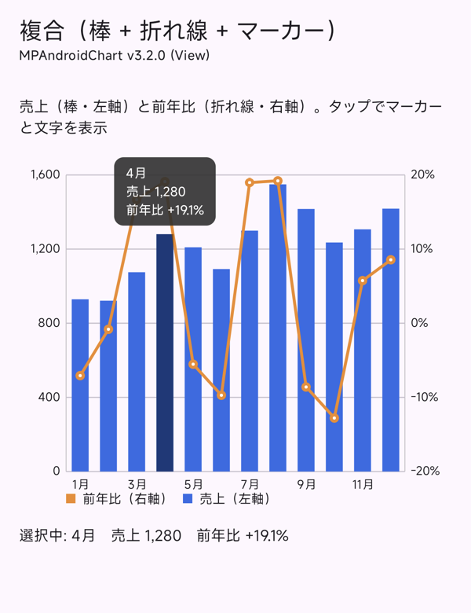
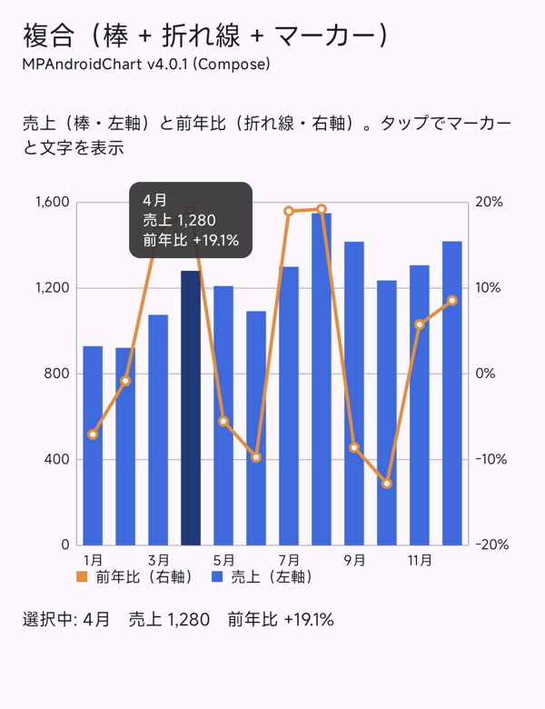
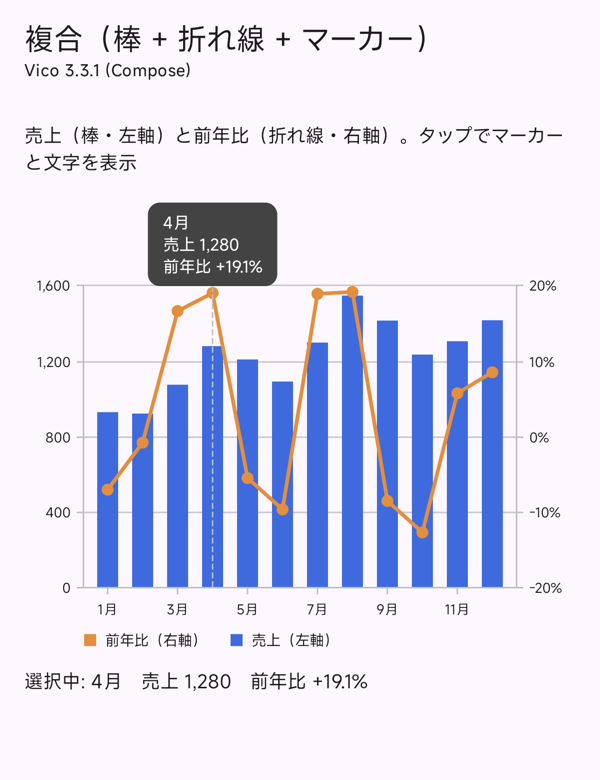

# AndroidGraphCompare

同じグラフを 3 つのライブラリ・書き方で実装し、**コード・見た目・性能**を比べるためのサンプルアプリです。

| flavor | ライブラリ | 書き方 |
|---|---|---|
| `mp3` | [MPAndroidChart](https://github.com/PhilJay/MPAndroidChart) v3.2.0 | View（Java）を `AndroidView` で包む |
| `mp4` | MPAndroidChart v4.0.1 + MPChartCompose | Kotlin で書き直された 4.x の chart composable |
| `vico` | [Vico](https://github.com/patrykandpatrick/vico) 3.3.1 | Compose（`compose` モジュール） |

<p>
  
  
  
</p>

## 画面

| 画面 | 内容 |
|---|---|
| 円 / ドーナツ | 中央の文字、割合の表示、タップでスライスを強調 |
| 棒 | 上半期 × 3 製品。グループと積み上げを切り替え、角丸 |
| 折れ線 | 2 系列、グラデーションのエリア塗り、曲線 |
| 複合 | 棒（左軸）+ 折れ線（右軸）、タップでマーカーと文字 |
| 大量データ | 10,000 点の折れ線をピンチズーム・スクロール |
| データ更新アニメーション | ボタンで 12 か月分を差し替え |
| LazyColumn | 30 個の小さな折れ線を並べてスクロール |

比べやすいよう、軸の範囲と目盛り・軸の幅・棒の太さ・凡例・色・文字の大きさは 3 実装で揃えています（`core` の `*Spec`）。
揃えるのに必要だった設定と、そこから見えたライブラリの違いは [docs/blog-notes.md](docs/blog-notes.md) にまとめています。

## 構成

```
core/       3 実装で共通のデータ（固定シード）、見た目の基準（ChartSpec など）、書式、共通の UI
app/        画面の一覧と、flavor ごとのグラフの実装（src/mp3, src/mp4, src/vico）
benchmark/  Macrobenchmark（起動・各画面の表示・ズームとスクロール・データ更新・LazyColumn）
docs/       比較のメモ、計測結果、スクリーンショット、動画、補助スクリプト
```

MPAndroidChart 3.x と 4.x はパッケージ名が同じで、1 つの APK に同居できません。そのため flavor ごとに依存を分け、
applicationId も分けています（`io.github.winschneid.graphcompare.mp3` など）。3 つを同じ端末に並べてインストールできます。

## ビルドと実行

必要なもの：JDK 17 以上（Android Studio 同梱の JBR で可）、Android SDK（compileSdk 37。MPChartCompose 4.0.1 の要件）、minSdk 24 以上の端末。

```bash
./gradlew assembleMp3Debug assembleMp4Debug assembleVicoDebug
```

Android Studio ではビルドバリアント（`mp3Debug` など）を選んで実行します。
MPAndroidChart は JitPack でのみ配布されているので、初回は JitPack からダウンロードします。

### Intent extra

adb から画面やテーマを指定して直接開けます（ベンチマークと撮影で使っています）。

```bash
adb shell am start -n io.github.winschneid.graphcompare.vico/io.github.winschneid.graphcompare.MainActivity --es screen combined --es theme dark
```

| extra | 値 |
|---|---|
| `screen` | `pie` / `bar` / `line` / `combined` / `large_data` / `animation` / `lazy_list` |
| `theme` | `dark` / `light`（なければ端末の設定に従う） |
| `decimation` | `true` で MPAndroidChart 4.x の間引き（`isDecimationEnabled`）を on（大量データの画面のみ） |

## ベンチマーク

release 相当（R8 あり、debug 署名）の `benchmark` ビルドで計測します。実機で、flavor ごとに実行します。

```bash
./gradlew :benchmark:connectedMp3BenchmarkAndroidTest
```

`Mp3` を `Mp4` / `Vico` に変えると、ほかの flavor を計測します。動作確認だけなら dry run（各テスト 1 回、計測なし）が速いです。

```bash
./gradlew :benchmark:connectedMp3BenchmarkAndroidTest -Pandroid.testInstrumentationRunnerArguments.androidx.benchmark.dryRunMode.enable=true
```

- 結果の JSON は `benchmark/build/outputs/connected_android_test_additional_output/` にできます。
  `docs/benchmark-results/<flavor>-benchmarkData.json` に置いて `python3 docs/benchmark-results/make_tables.py docs/benchmark-results` を実行すると、記事用の表になります。
- 端末によっては USB 経由のインストールのたびに承認が要ります。承認されないと `INSTALL_FAILED_USER_RESTRICTED` で止まりますが、
  Gradle は BUILD SUCCESSFUL のまま終わるので、ログを確認してください。
- 大量データのベンチマークを電池駆動・温度を揃えて回すスクリプトもあります（[benchmark/scripts/large_data_on_battery.sh](benchmark/scripts/large_data_on_battery.sh)）。

## 結果の概要

1 台（POCO 26077PC53G、Android 16）での結果です。詳しい条件と表は [docs/blog-notes.md](docs/blog-notes.md) を見てください。

- **起動・画面表示**：3 実装の差はばらつきの範囲
- **大量データのズームとスクロール**：遅延したフレームは 3.2.0 と 4.0.1 が 2.7%、Vico が 24.5%。
  4.0.1 は間引き（`isDecimationEnabled`）を on にすると 0.4%
- **データ更新アニメーション・LazyColumn**：3 実装とも遅延したフレームは 2% 未満
- **APK サイズ**（release）：3.2.0 が 1,080 KB、4.0.1 が 1,111 KB、Vico が 1,143 KB
- **実装量**：4.0.1 が一番少なく、Vico は見た目を揃えるためのコードの分だけ多い

## docs

| パス | 内容 |
|---|---|
| [docs/blog-notes.md](docs/blog-notes.md) | 実装して見えた違い、揃えるのに必要だった設定、実装量、移行メモ、計測結果 |
| [docs/benchmark-results/](docs/benchmark-results/) | Macrobenchmark の生の結果と、表を作るスクリプト |
| [docs/images/](docs/images/) | 各画面のスクリーンショット（`<画面>-<flavor>-<light/dark>.png`） |
| [docs/videos/](docs/videos/) | データ更新アニメーションの動画 |
| [docs/scripts/](docs/scripts/) | 撮影スクリプト、実装量を数えるスクリプト |
