# 【Android】MPAndroidChart 3.2・4.0 と Vico を同じグラフで比べてみた 〜Compose時代のグラフ選び〜

## はじめに

こんにちは、Androidエンジニアの佐藤です。

アプリでグラフを扱う機会は多いと思います。ウェルスナビのアプリでも、ホーム画面の資産推移をはじめ、グラフはユーザーが毎日目にする大事な部品です。

Android のグラフライブラリといえば長く MPAndroidChart が定番でしたが、2026 年の夏から秋にかけて大きな動きがありました。

- 🆕 **MPAndroidChart 4.0**（9 月）：Kotlin で書き直され、Jetpack Compose 用のモジュール（MPChartCompose）が付いた。あわせて 3.x 系の最終版 **3.2.0** も公開
- 🆕 **Vico 3.3**（8 月）：Compose 製のグラフライブラリ。「Compose が主」の方針になり、View 版は重大な修正のみに。3.x では円グラフも追加

「Compose で作るなら、4.0 と Vico のどちらがいいのか？」「3.x から上げるならどっちに行くべきか？」が気になったので、**同じグラフを 3 つの書き方で実装し、コード・見た目・性能を比べてみました**。
今回はその結果と、比べる過程でハマったところをまとめました。
以降、MPAndroidChart 3.2.0 を **MP3**、4.0.1 を **MP4** と書きます（サンプルアプリの flavor 名と同じです）。

:::message
⚠️ 注意事項
記事中のコードは、比較用に作ったサンプルアプリのものを説明用に簡略化しています。
ライブラリのバージョンは 2026 年 10 月時点のもの（MPAndroidChart 3.2.0 / 4.0.1、Vico 3.3.1）です。
:::

コードはすべて GitHub に置いています。
https://github.com/ksdev7091/AndroidGraphCompare

### この記事の対象読者

- MPAndroidChart 3.x を使っていて、4.0 に上げるか、Vico に移るかを迷っている方
- Jetpack Compose で新しくグラフを作るにあたって、ライブラリを選んでいる方
- 「ライブラリの既定の見た目の違い」に振り回された経験がある方
- Macrobenchmark で描画の性能を比べたい方

## 結論から

先に結論を書いておきます。

| こんなとき | おすすめ |
|---|---|
| View の 3.x を使っている | **MP4 に上げる**。書き換えはプロパティ名が中心で、大量データなら間引きで速くなる |
| Compose で新しく作る・グラフは折れ線と棒が中心 | **Vico**。Compose らしく書け、アニメーションも自然。ただし大量データでは遅延が多かった |
| Compose で新しく作る・レーダーや散布図も使う、大量データを扱う | **MP4**。中身は View だが、chart composable と Composable のマーカーで Compose から十分使いやすい |
| Kotlin Multiplatform で共有したい | **Vico** |

「Compose ネイティブだから Vico」と選びたくなるところですが、実際に揃えて比べてみると、**MP4 は「中身は View」という点を除けば、Compose からも十分使いやすく、機能も性能も強い**という結果になりました。

以降では、何をどう比べたのか、どこでハマったのかを詳しく解説します。

## 1. 比べ方

### 3 つの実装

| 略称 | ライブラリ | 書き方 |
|---|---|---|
| MP3 | MPAndroidChart 3.2.0 | View を `AndroidView` で包む |
| MP4 | MPAndroidChart 4.0.1 + MPChartCompose | 4.x の chart composable |
| Vico | Vico 3.3.1 | Compose |

### 作ったグラフ

| 画面 | 内容 | 主に比べること |
|---|---|---|
| 円 / ドーナツ | 中央の文字、割合、タップでスライスを強調 | 機能の有無 |
| 棒 | グループ / 積み上げの切り替え、角丸 | データの持ち方、切り替え |
| 折れ線 | 2 系列、グラデーションのエリア塗り、曲線 | 見た目の作り方 |
| 複合 | 棒（左軸）+ 折れ線（右軸）、タップでマーカーと文字 | マーカー、選択状態の受け取り方 |
| 大量データ | 10,000 点をピンチズーム・スクロール | 描画の性能 |
| データ更新 | ボタンで 12 か月分を差し替えてアニメーション | アニメーション |
| LazyColumn | 30 個の小さな折れ線を並べてスクロール | リストの中での性能 |

### 1 つのアプリで 3 つを比べる

最初にぶつかったのが、**MPAndroidChart 3.x と 4.x は 1 つの APK に入れられない**ことです。
4.0 は「パッケージ名もクラス名も 3.x と同じ」（`com.github.mikephil.charting`）なので、両方入れるとクラスが重複してビルドが通りません。

そこで product flavor を 3 つ作り、flavor ごとに依存と applicationId を分けました。3 つのアプリを同じ端末に並べて入れられるので、見比べるのにも便利です。

```kotlin
productFlavors {
    create("mp3") { dimension = "chart"; applicationIdSuffix = ".mp3" }
    create("mp4") { dimension = "chart"; applicationIdSuffix = ".mp4" }
    create("vico") { dimension = "chart"; applicationIdSuffix = ".vico" }
}
dependencies {
    "mp3Implementation"(libs.mpandroidchart3)
    "mp4Implementation"(libs.mpandroidchart4.lib)
    "mp4Implementation"(libs.mpandroidchart4.compose)
    "vicoImplementation"(libs.vico.compose)
}
```

データ（固定シードで生成）、見た目の基準、書式は共通の `core` モジュールにまとめ、3 実装から同じものを使っています。

### 導入まわり

| | MP3 | MP4 | Vico |
|---|---|---|---|
| 配布 | JitPack | JitPack | Maven Central |
| minSdk | 14 | 23 | （今回は 24 で統一） |
| compileSdk | - | 35（Compose は 37） | - |
| release APK（全 7 画面） | 1,080 KB | 1,111 KB | 1,143 KB |

APK サイズの差は 60KB ほどで、選ぶ決め手になるほどではありませんでした。

## 2. 見た目を揃える：ここが一番ハマった

既定の見た目のまま比べると、「どれが速いか・書きやすいか」より「既定値の違い」ばかりが目立ってしまいます。
そこで、軸の範囲と目盛り、y 軸の幅、棒の太さ、凡例の形と位置、色、文字の大きさを 3 実装で揃えることにしました。

……と、さらっと書きましたが、**実はこの「揃える」作業でいちばんライブラリの違いが見えました**。

### 複合グラフで起きたこと

最初に作ったのは、棒（売上・左軸）と折れ線（前年比・右軸）の複合グラフです。とりあえず動かしてみると、MPAndroidChart の 2 つはほぼ同じ見た目なのに、Vico だけ様子が違いました。

- ❌ 12 か月分あるはずが、**8 月までしか見えない**
- ❌ 点線の補助線が**二重**に引かれている
- ❌ 右軸の目盛りが -10%, -5%, 0%, 4%, 8%… と**半端な値**

原因はどれも、Vico と MPAndroidChart の考え方の違いでした。

| 揃えたいこと | MPAndroidChart | Vico |
|---|---|---|
| 12 か月を画面に収める | 範囲を画面幅に合わせて描くので何もしなくてよい | x の間隔が dp で決まり、はみ出した分はスクロールになる。`Zoom.Content` で全体が収まる倍率にする |
| 補助線を 1 組にする | 右軸の補助線を消す | 既定では全部の軸が点線の補助線を引く。右軸と x 軸の補助線を消し、左軸を実線にする |
| 軸の範囲と目盛り | 軸に `axisMinimum` / `axisMaximum`、目盛りは**数**で指定 | 範囲は**レイヤー**に `CartesianLayerRangeProvider`、目盛りは**間隔**で指定 |
| 描画領域の左右の端 | y 軸の幅を `minWidth` / `maxWidth` で固定 | `BaseAxis.Size.Fixed` で固定 |
| 凡例 | 既定で出る。描画領域の左端から並ぶ | 自分で並べる。Canvas の左端から並ぶので、y 軸の幅だけずらす |

| MP3 | MP4 | Vico |
|---|---|---|
|  |  |  |

### 棒の太さが揃わない

軸と凡例が揃って、これで完成かと思いきや――**Vico の棒だけ細いまま**でした。

MPAndroidChart は棒の太さを「x の 1 区間に対する割合」（`barWidth = 0.6`）で指定しますが、Vico は「太さと間隔を dp」で指定します。
そこで比率から dp に換算したのですが、それでも細いまま。スクリーンショットの画素を数えてみると、差ははっきりしていました。

| MP3 / MP4 | Vico（調整前） | Vico（調整後） |
|---|---|---|
| 棒 42px、間隔 72px（0.58） | 棒 32px、間隔 70px（0.45） | 棒 42px、間隔 70px（0.60） |

Vico のソースを追ってみると、原因は 2 つありました。

1. **折れ線レイヤーの x 間隔は「点の大きさ + `pointSpacing`」で決まる**。棒のレイヤーより広くなっていたので、全体がそちらに合わせて縮み、棒も細くなっていた
2. **x 軸の端のラベルが切れないよう、既定で両端に余白が足される**（`addExtremeLabelPadding`）

この 2 つを調整して、ようやく揃いました 🎉
残った 3% の差は、Vico が折れ線の点が切れないよう、点の半分を拡大縮小しない余白として必ず取るためで、設定では消せませんでした。

### マーカーと選択状態

複合グラフでは、タップしたときのマーカーと「選択中の値」の受け取り方にも違いがありました。

| | マーカー | 選択状態 |
|---|---|---|
| MP3 | XML レイアウト + `MarkerView` を継承 | `OnChartValueSelectedListener` から Compose の state に書き戻す |
| MP4 | **Composable** で書ける | `ChartState.selectedEntry` を読むだけ |
| Vico | Canvas に描く `TextComponent`（Composable は置けない） | `CartesianMarkerVisibilityListener` |

MP4 では、マーカーも選択状態も Compose の中で完結します。

```kotlin
// MP4：マーカーも選択状態も Compose の中で完結する
val state = rememberChartState()
CombinedChart(
    data = data,
    state = state,
    marker = { entry, _ -> (entry.data as? CombinedPoint)?.let { MarkerBubble(ChartFormat.markerText(it)) } },
    setup = { configure() },
)
Text("選択中: ${(state.selectedEntry?.data as? CombinedPoint)?.let(ChartFormat::markerText)}")
```

ほかにも細かな違いがありました。

- MP4 の `Entry` は型付きの payload（`Entry<CombinedPoint>`）を持てる。MP3 も `data` に入れられるが `Object` なのでキャストが必要。Vico は数値しか渡せないので、x 座標から元のデータを引き直した
- MPAndroidChart はタップするとマーカーが出たままになるが、Vico の既定は「押している間だけ」

### なぞったときの動き

マーカーを出したまま指をずらすとどう動くかも確かめました。`adb shell input motionevent` で「4 月の棒に指を置く → 置いたまま 7 月、10 月へずらす → 離す」を 1 段階ずつ送り、そのつどスクリーンショットを撮っています。

最初は 3 つともばらばらでした。

| | 指を置いた瞬間 | なぞっている間 | 離したあと |
|---|---|---|---|
| MP3 | 出ない | ❌ 出ない | 出ない |
| MP4 | 出ない | ✅ 指に合わせて動く | 出たまま |
| Vico | 出ない | ❌ 出ない | 出ない |

MP4 が一番自然です。MP3 と Vico が動かなかったのは、比較のために入れた設定が原因でした。

- **MP3**：ドラッグと拡大縮小を両方無効にすると、タッチの移動をまるごと無視する作りでした（`BarLineChartTouchListener`）。「なぞってハイライト」も、ドラッグが有効なときの分岐の中にしかありません。拡大縮小は無効のまま `isDragEnabled = true` にすると、全体表示から動かずに、なぞると追従するようになりました
- **MP4**：ドラッグを無効にしていても、なぞると追従します。書き直しで変わったところなので、3.x から上げると動きが変わります
- **Vico**：タップで出したままにするために使っていた `rememberToggleOnTap()` はタップにしか反応せず、既定の `rememberShowOnPress()` はなぞると追従するものの離すと消えます。MP4 と同じ動きにするには、`CartesianMarkerController` を自作する必要がありました

```kotlin
// Vico：なぞると追従し、離しても残り、同じ場所をもう一度タップすると消える
private class FollowAndStayMarkerController : CartesianMarkerController {
    private var isPressed = false
    private var shownTargets: List<CartesianMarker.Target>? = null
    // 指のタップにはわずかななぞりが混じるので、消すかどうかは押した瞬間の表示と比べて決める
    private var shownTargetsAtPress: List<CartesianMarker.Target>? = null

    override val acceptsLongPress = false
    override val consumeMoveEvents = true // スクロールを止めているので、なぞる動きはマーカーで受け取る

    override fun shouldAcceptInteraction(interaction: Interaction, targets: List<CartesianMarker.Target>) =
        when (interaction) {
            is Interaction.Press -> { isPressed = true; shownTargetsAtPress = shownTargets; false }
            is Interaction.Release -> { isPressed = false; false }
            is Interaction.Move -> isPressed && targets.isNotEmpty()
            is Interaction.Tap -> targets.isNotEmpty()
            else -> false
        }

    override fun shouldShowMarker(interaction: Interaction, targets: List<CartesianMarker.Target>): Boolean {
        val show = interaction is Interaction.Move || targets != shownTargetsAtPress
        shownTargets = if (show) targets else null
        return show
    }
}
```

揃えたあと、10 月の棒の上までなぞったところです。

| MP3 | MP4 | Vico |
|---|---|---|
| 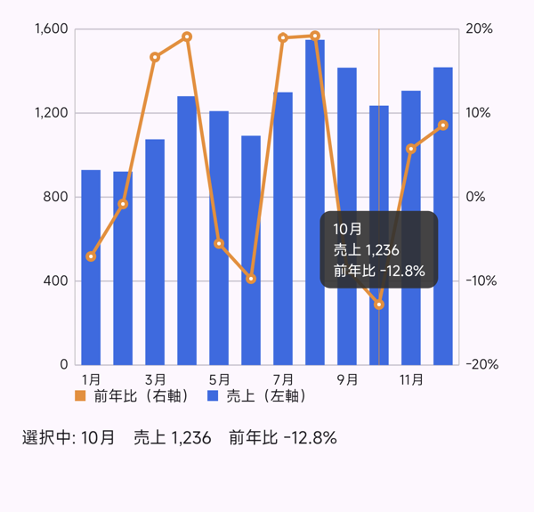 | 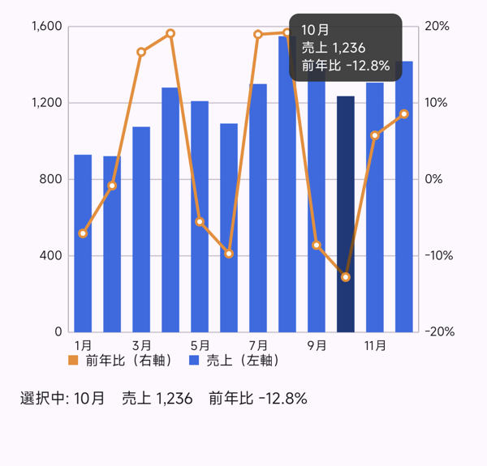 | 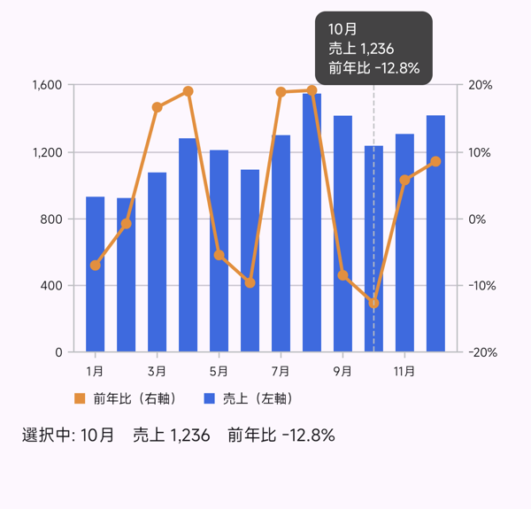 |

よく見ると、**MP3 だけ棒ではなく折れ線の点が選ばれています**（棒が濃くならず、オレンジの縦線が出ている）。指の位置は 10 月の棒の内側ですが、折れ線の点のすぐ近くでした。
これは「複合グラフで棒の中をタップしても、近くの折れ線の点が選ばれる」問題で、MP4（4.0.1）のリリースノートで修正されたもの（#5207）です。表示される値は同じ 10 月のものなので気づきにくいですが、こうして並べると違いがわかります。

## 3. グラフ別に見えた違い

### 円グラフ：Vico には「ない」機能を自前で

| MP3 | MP4 | Vico |
|---|---|---|
| 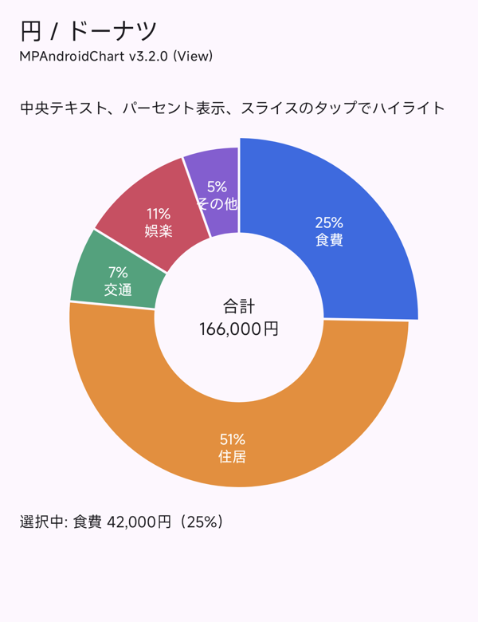 |  | 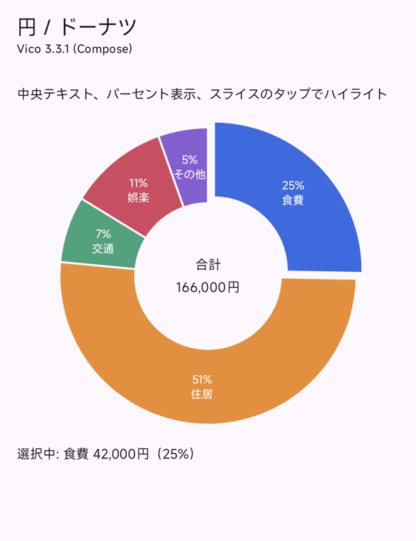 |

MPAndroidChart は、中央の文字・割合の計算・タップでのスライスの強調が**設定だけ**でできます。
一方、Vico の PieChart にはどれもないので、Compose で作りました。

- 中央の文字：`PieChartHost` の上に `Text` を重ねる
- タップ：`pointerInput` でタップ位置の角度と中心からの距離を求め、どのスライスかを計算する。選んだスライスは `offsetFromCenter` で外へずらす

Compose なので重ねるのは簡単ですが、タップの判定まで自前で書くのはなかなかの手間です。

さらに実機で動かしてみると、**スライスを選ぶたびに円全体が縮む**ことに気づきました。
MPAndroidChart は最初から「ずらす量」の分だけ円を小さくしておくので大きさは変わりませんが、Vico は「指定した半径 − 一番大きいずらし量」で描くためです。選択中だけ直径を大きく指定して揃えました。

なお、選択時にずらす量の既定値は MP3 が 18（px のまま）、MP4 が 9dp と、ここも違います。

### 棒グラフ：切り替えたら積み上げが崩れた

| MP3 | MP4 | Vico |
|---|---|---|
|  | 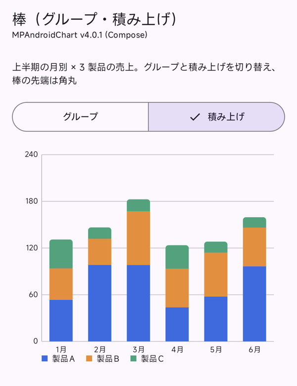 | 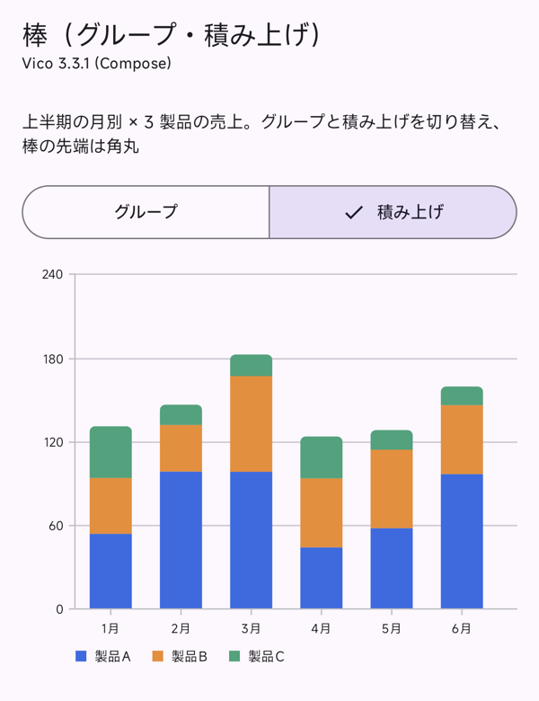 |

グループ表示と積み上げ表示をボタンで切り替えられるようにしました。

- **データの持ち方**：MPAndroidChart は、グループなら系列ごとに `BarDataSet` を作って `groupBars`、積み上げなら値を配列で持つ `BarEntry` 1 つ、と**表示方法でデータの形が変わります**。Vico はデータはそのままで、`MergeMode`（`Grouped` / `Stacked`）を変えるだけです
- **角丸**：MP3 には設定がありません。MP4 は `barCornerRadius` で、グループは 4 隅、積み上げは一番上の区画の上側だけを丸めます。Vico は Compose の `Shape` で渡しますが、区画ごとに当てるので、そのままだと途中の区画まで丸くなります

そして Vico でハマったのが切り替えです。積み上げに切り替えると、**y 軸が 0〜100 のまま（本来は 0〜240）で、棒の上が切れてしまいました**。

調べてみると、Vico の y の範囲は ModelProducer の transaction を流したときに計算されます。表示方法だけを変えても、データが前回と同じだと計算し直されません。
表示方法を `ExtraStore` に入れて、transaction ごと流し直すことで解決しました。

### 折れ線：曲線の「なめらかさ」が違う

| MP3 | MP4 | Vico |
|---|---|---|
|  | 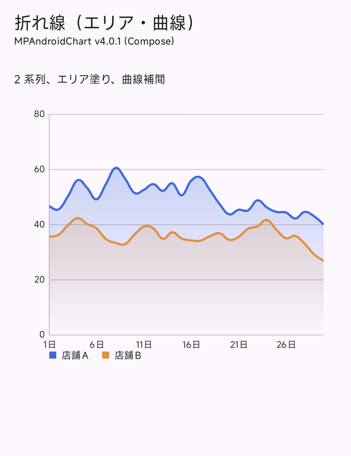 | 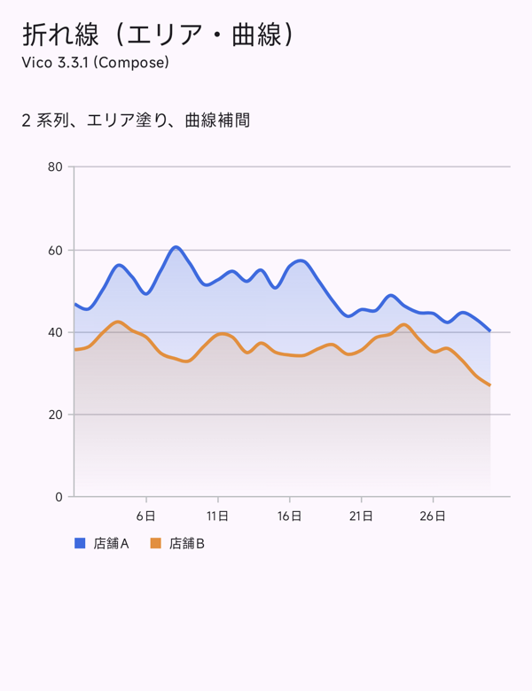 |

- **グラデーション**：MPAndroidChart は 3.x も 4.x も `fillDrawable` に `GradientDrawable` を渡します（View の API のまま）。Vico は Compose の `Brush.verticalGradient` をそのまま使えます
- **曲線**：Vico の `Interpolator.cubic()` は点の間で角が残り、直線に近く見えました。MPAndroidChart の `CUBIC_BEZIER` に近いのは `catmullRom()` でした
- **端のラベル**：MPAndroidChart は左端の「1日」を左にはみ出して描きますが、Vico は描けません。ラベルの最大幅が「端までの距離の 2 倍」に制限されるためです

### ダークテーマ

| MP3 | MP4 | Vico |
|---|---|---|
|  | 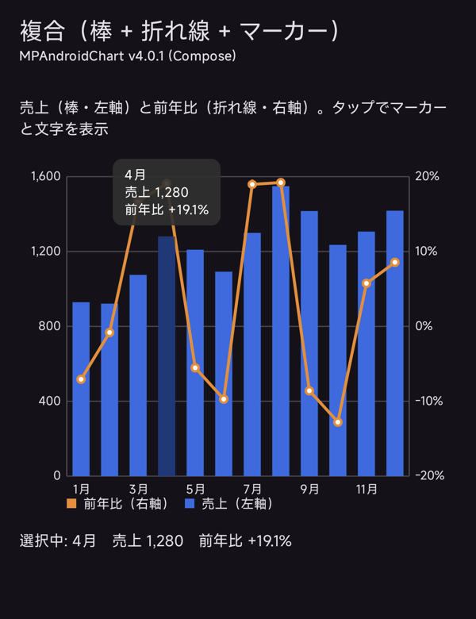 | 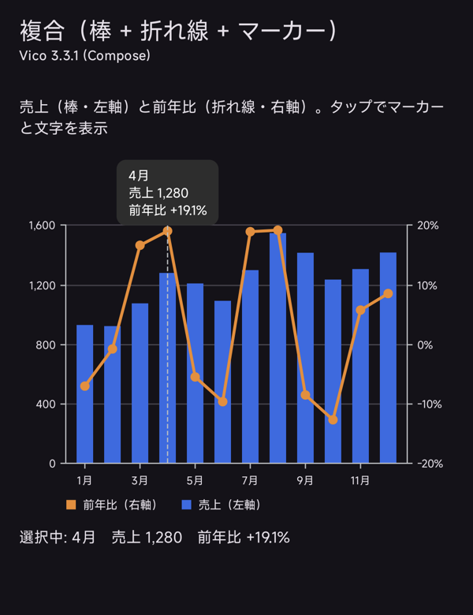 |

MPAndroidChart は中身が View なので、Compose の `MaterialTheme` の色は自動では反映されません。文字や補助線の色を `update` で塗り直しています（MP4 も同じ）。
Vico は Compose の色をそのまま渡せます。

### データ更新アニメーション：MP3 は「伸び直す」

動画：[MP3](videos/animation-mp3.mp4) / [MP4](videos/animation-mp4.mp4) / [Vico](videos/animation-vico.mp4)

| | 前の値から新しい値へ動かせるか | 書き方 |
|---|---|---|
| MP3 | ❌ | 差し替えたあと `animateY` で 0 から伸ばし直す |
| MP4 | ✅ | chart composable に `animateChanges = true`（300ms 固定）。View なら `animateDataChange(data, ms)` |
| Vico | ✅ | ModelProducer に新しいデータを流すだけ。`animationSpec` で時間と動き方を変えられる |

MP3 の「0 から伸び直す」動きでは、どこがどれだけ変わったのかが追えません。MP4 で一番うれしい変化の 1 つだと思います。

### LazyColumn

- MP3 も MP4 も、行ごとに View を作ります（MP4 の chart composable も中身は `AndroidView`）。チャートがタッチを奪わないよう `isTouchEnabled = false` にしました
- Vico は Compose で描くので View は作りません。データを更新しないなら、ModelProducer を使わずに `CartesianChartModel` を直接渡せます

## 4. 性能を測る

Macrobenchmark で、release 相当のビルドを実機（POCO 26077PC53G、Android 16）で計測しました。

### 起動・画面表示

3 実装の差は**ばらつきの範囲**でした。どれも 120〜180ms ほどで、範囲が大きく重なっています。

### 大量データ：はっきり差が出た

10,000 点の折れ線をピンチで拡大し、左右にスクロールして、縮小するまでのフレームを測りました。

1 回目の計測で Vico だけ遅延が目立ったのですが、充電しながら測っていたうえ、開始時の端末の温度も揃っていませんでした。
これでは「たまたま」の可能性が消せないので、条件を揃えて測り直しています。

- 充電を外し、電池駆動で計測（端末の中でスクリプトを回し、USB ケーブルを抜いても続くようにした）
- 各計測の前に、電池の温度が 35℃ に下がるまで待つ
- 4 つの条件を 3 周交互に回し、各 15 回

| | MP3 | MP4 | MP4 + 間引き | Vico |
|---|---:|---:|---:|---:|
| フレームの CPU 時間 P50（ms） | 6.5 | 6.0 | 6.0 | 8.4 |
| フレームの CPU 時間 P99（ms） | 16.8 | 16.8 | 10.4 | 30.4 |
| 締め切り超過 P99（ms、正なら遅延） | +6.6 | +6.6 | −1.0 | +21.3 |
| **遅延したフレームの割合** | 2.7% | 2.7% | **0.4%** | **24.5%** |

- Vico は **4 フレームに 1 フレームが遅延**しました。3 周とも 23〜27% で安定していて、偶然ではありません
- 既定の設定では、MP3 と MP4 に差はありませんでした
- MP4 で**間引き（`isDecimationEnabled = true`）を on** にすると、遅延したフレームが 0.4% まで減りました 🎉
  同じ画素の列に重なる点を間引く機能なので、10,000 点を 300dp ほどの幅に描くこのケースでは、見た目はほぼ変わりません

### データ更新アニメーションと LazyColumn

| | MP3 | MP4 | Vico |
|---|---:|---:|---:|
| データ更新：遅延したフレームの割合 | 0.1% | 0.1% | 1.6% |
| LazyColumn：遅延したフレームの割合 | 0.5% | 0.3% | 0.2% |

Vico はデータ更新のフレームの CPU 時間が MPAndroidChart の約 2 倍でしたが、遅延はわずかでした。LazyColumn は 3 実装とも問題ありませんでした。

### 計測でハマったこと

計測そのものにも、いくつか落とし穴がありました。

- **`AndroidView` に直接付けた testTag が UiAutomator から見つからない**：中の View のアクセシビリティ情報に隠れてしまうため。Compose の `Box` で包んで、そこに付けるようにしました
- **インストールが静かに失敗する**：一部の端末では USB 経由のインストールのたびに端末側の承認が必要です。承認されないと `INSTALL_FAILED_USER_RESTRICTED` で止まりますが、**Gradle は BUILD SUCCESSFUL のまま終わる**ので、ログを見ないと気づけません
- **温度で結果がぶれる**：前の計測の熱が残ったまま次を測ると、条件が揃いません。上のとおり、電池駆動で冷ましながら交互に回すのが確実でした

:::message
1 台・各 5〜15 回の結果なので、数 % の差はばらつきの範囲として扱っています。また、3 実装とも事前コンパイルなし（`run-from-apk`、JIT のみ）の状態です。
:::

## 5. 実装量と機能

### 実装量

空行・コメント・import を除いたコードの行数です。

| | MP3 | MP4 | Vico |
|---|---:|---:|---:|
| 円 | 49 | 42 | 76 |
| 棒 | 64 | 63 | 86 |
| 折れ線 | 49 | 50 | 58 |
| 複合 | 87 | 69 | 148 |
| 大量データ / データ更新 / LazyColumn | 139 | 130 | 162 |
| 共通のスタイル | 48 | 49 | 39 |
| XML（マーカー） | 14 | - | - |
| **合計** | **450** | **403** | **569** |

MP4 が一番短く書けました。Vico が長いのは、見た目や動きを MPAndroidChart に揃えるためのコード（凡例を並べる、余白を dp で合わせる、円グラフのタップ判定、なぞったときのマーカーの制御）が多いためです。Vico の既定の見た目で良ければ、もっと短くなります。

### 機能対応表

| | MP3 | MP4 | Vico |
|---|:---:|:---:|:---:|
| 折れ線・棒・複合・ローソク足・円 | ✅ | ✅ | ✅ |
| 横棒・散布図・バブル・レーダー | ✅ | ✅ | ❌ |
| 円の中央の文字・タップでの強調 | ✅ | ✅ | ❌（自前） |
| 棒の角丸 | ❌ | ✅ | ✅（Shape） |
| マーカー | View + XML | Composable | TextComponent |
| なぞってマーカーを動かす | ✅（ドラッグが有効なとき） | ✅ | 🔺（離すと消える。残すなら自作） |
| 凡例 | 自動 | 自動 | 手動 |
| 前の値からのアニメーション | ❌ | ✅ | ✅ |
| 大量データの間引き | ❌ | ✅ | ❌ |
| 空状態・ローディングの表示 | 文字だけ | ✅（新しい空状態、`isLoading`） | placeholder の枠 |
| Compose での使い方 | AndroidView で包む | chart composable（中身は View） | ネイティブ |
| Kotlin Multiplatform | ❌ | ❌ | ✅ |

## 6. MP3 → MP4（3.2.0 → 4.0.1）の移行

パッケージ名もクラス名も同じなので、import はほぼそのまま使えます。主な書き換えは **getter / setter から Kotlin のプロパティへ**です。

```kotlin
// MP3（3.2.0）
xAxis.setDrawGridLines(false)
dataSet.setDrawValues(false)
axisLeft.setLabelCount(5, true)
dataSet.setCircleColor(color)

// MP4（4.0.1）
xAxis.isDrawGridLinesEnabled = false
dataSet.isDrawValuesEnabled = false
axisLeft.labelCount = 5; axisLeft.isForceLabelsEnabled = true
dataSet.circleColor = color
```

- 配列の引数はリストになった（`drawOrder`、`stackLabels`、積み上げの `BarEntry`）
- `Entry` が型付きの payload を持てるようになった（`Entry(x, y, data = point)`）
- **触ったときの動きが変わる**ものがある：ドラッグを無効にしていても、なぞるとマーカーが動く。複合グラフで棒の中をタップすると、近くの折れ線の点ではなく棒が選ばれる
- **既定値が変わって見た目が変わる**ものがある：軸線と補助線の太さ（1dp → 0.5dp）、円グラフの選択時にずらす量（18px → 9dp）
- Compose で使うなら、`AndroidView` の `factory` / `update` を chart composable の `setup` / `update` に移すだけで、設定の中身はほぼそのまま使える

なお、3.1.0 の `ValueFormatter` を使っていた場合は、3.2.0 の時点で 3.0.x の `IAxisValueFormatter` に戻っています。MP4 も同じ書き方です。

## 7. 学んだこと

### 1. 「揃えて比べる」と、ライブラリの設計思想が見える

既定値のまま比べていたら、「Vico は 8 月までしか出ない」「棒が細い」で終わっていたと思います。
揃えようとしたことで、**MPAndroidChart は範囲を画面に合わせて描き、Vico は dp で並べてはみ出したらスクロールする**という、根本的な考え方の違いが見えてきました。どちらが良い悪いではなく、得意な場面が違うということです。

### 2. 迷ったらソースを読む

棒の太さ、積み上げの崩れ、円が縮む問題は、どれもドキュメントだけでは原因がわかりませんでした。
Vico も MPAndroidChart もソースが公開されているので、該当箇所を読むのが一番の近道でした。

### 3. 性能は条件を揃えて、繰り返して測る

1 回目の計測だけで「Vico は遅い」と書くこともできましたが、充電中・温度ばらばらの結果では説得力がありません。
電池駆動・温度を揃えて・交互に回して測り直したことで、**差が偶然ではないこと**と、**MP4 の間引きがこれほど効くこと**の両方がはっきりしました。

## おわりに

Compose の時代になって、グラフライブラリの選択肢は「MPAndroidChart 一択」ではなくなりました。

- 📈 3.x を使っているなら、**MP4 への移行はかなり素直**。大量データなら間引きも効く
- 🧩 Compose で書くなら、**Vico は書き味が良い**が、見た目を作り込むほどコードが増え、大量データには課題がある
- ⚖️ 「Compose ネイティブかどうか」だけで選ばず、**必要なグラフの種類とデータ量**で選ぶのがよさそう

今回のサンプルアプリは、見た目を揃えるための設定も、計測のスクリプトも含めて GitHub に置いています。
同じようにグラフライブラリ選びで迷っている方の参考になれば幸いです。
